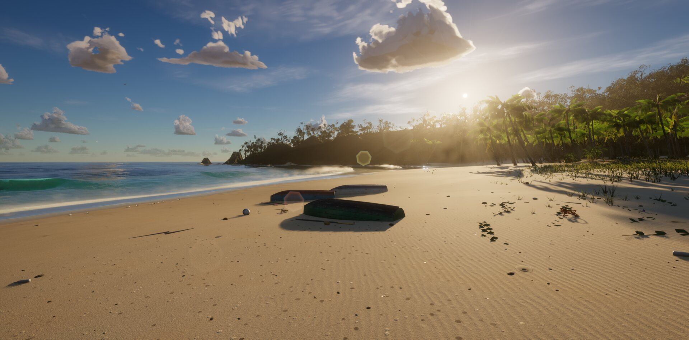

# Hyptile Island

An island fishing game for the browser, built on [Tidewater](https://github.com/dgreenheck/tidewater) by Dan
Greenheck: his tropical island, FFT ocean, sky, village and fishing, with a new layer on top. You play one of
the eight Hyptile-family characters from the owner's Unreal fishing project, start on foot with a rod, earn a
boat from Captain Roid at the yard, take PoorGoat's quests and rolling orders out past the reef, and fish the same island
with friends over a small relay server: name tags, chat and one shared island clock. It runs directly on WebGPU
and WGSL with its own small rendering engine, no framework.




## Requirements

- A browser with WebGPU: a recent Chrome, Edge or Safari.
- A capable GPU. Tidewater targets 60 fps at 2560×1267 on an Apple M5 Pro, and dynamic resolution scales
  the render down on slower machines. Each roster character is a 48-joint skinned mesh of about 60 k
  triangles, so a crowded multiplayer beach costs more than solo play.
- The first load compiles several hundred shaders, which can take a minute or more. Later visits are
  faster because the browser caches them.

## Features

**Characters: the crew**
- Eight playable characters on one shared 48-bone rig (`src/game/Characters.js`): **Hyptile** (yours from the
  start), **Pepe**, **BONK** and **The Clown** (hired for island dollars at Ethena Prosper's), and **Doge**, **PENGU**,
  **Bravile** and **Heptyle** (earned by finishing one of PoorGoat's story quests).
- A third-person avatar driven by the rig's own clips: idle, walk, run and jump, the fishing cast / hold / reel /
  strike, swimming (idle, forward, fast), the helm and seated poses, catch celebrate / disappointed, talk,
  dance, look around, cheer and wave. Walk, run and swim playback rates follow your real speed so the feet
  don't slide.
- The crew panel (K) switches character, shows who is unlocked, and how to earn the rest.

**Boats**
- You start on foot and fish the pier, the beach and the shallows. Boats are bought from Captain Roid (his recorded clicks included) at the yard east of the pier, not far
  the boathouse and moored at the pier head (`src/game/Boats.js`).
- Five boats: the four fleet hulls from the fishing workspace (**marsh skiff** $650, **outrigger canoe**
  $1200, **sail cutter** $2600, **cabin launch** $4500) and Tidewater's procedural **lobster boat** ($9000).
  One boat at a time: buying another trades the old one in at 60 % of its price.
- Each hull has its own mass, thrust, pitch response, fuel-tank and hold multipliers.

**Quests at PoorGoat's**
- Story quests (reef run, night shift, deep water, record hunter) that unlock crew, and rolling orders for
  particular fish that pay over the counter price. Quest logic and rewards live in `src/game/Contracts.js`.

**Multiplayer**
- `npm run server` starts a WebSocket relay; open the game with `?server=ws://host:8765/island` to join.
  Everyone sees everyone's avatar, boat, name tag and chat (Enter), and the island clock is shared, so dawn
  and dusk happen together. Progress stays local to each browser.

**Fishing** (Tidewater)
- A spinning rod and reel that cast, reel and bend under load, with the bail, rotor and crank animated.
- Bites that depend on the water (shallows, pier, reef, bay, deep water), depth and time of day, across
  18 Caribbean species.
- A line-tension fight: keep the tension in the green band, ease off when the fish runs.
- A full-screen catch card with the fish's length and weight, a fish log with records, and a cooler.
- PoorGoat's fish stand buys your catch; Ethena's chandlery sells line, reels, rods, a bigger hold, fuel, a rebuilt
  engine, a fish finder and deck floodlights for night fishing.
- Walk the deck and the wheelhouse while the boat drifts; the boat burns fuel.
- A first-play guide, contextual tips and a minimap. Progress is saved in the browser.

**Ocean**
- Four-cascade FFT ocean (Tessendorf spectra) with foam, whitecaps, wind streaks and swell.
- Depth-aware breaking waves with peeling shoulders, whitewater, spray and foam lace.
- A shallow-water simulation for swash running up and down the sand.
- Boat wake and bow spray, and a whale wake.
- Caustics on the seabed and in the water, with light shafts.
- A split underwater/above-water view at the waterline, with water droplets on the lens after surfacing.
- Refraction of the seabed through the surface, including behind the pier and boats.

**Sky**
- Physically based atmosphere (Hillaire 2020) with a sun, moon and stars.
- Volumetric cumulus and wispy cirrus with cloud shadows on the land.
- Aerial perspective and sea haze.
- God rays, and a lens flare with occlusion.

**World**
- An island with a beach, hills, headlands and rocks.
- A fishing village, a pier, and the vendors' stalls built from Poly Haven scans.
- Realistic vendor characters (Microsoft Rocketbox) with skinned animation.
- A coral reef with fish.
- Palms, bananas, monstera, elephant ear, heliconia, bird of paradise, broadleaf trees, shrubs and dune
  grass, with impostors and dithered LOD fades.
- Beach debris.
- Birds, crabs and marine snow.
- A humpback whale with an escort of fish, blows, fluke dives and breaches.

**Lighting and post**
- Cascaded shadows with contact-hardening penumbrae, and screen-space contact shadows.
- Ground bounce light.
- GTAO ambient occlusion.
- Temporal upscaling and sharpening.
- Bloom, auto exposure and motion blur.
- Night lighting from lanterns, windows and the boat, plus a flashlight that also works underwater.

**Audio**
- Positional audio from real CC0 field recordings: surf timed to each breaking wave, wind, birds, the boat
  engine, footsteps by surface, underwater ambience, whale song, and the rod and reel (casts, the bail,
  reeling, the drag, line snaps, splashes).

## Controls

| Key | Action |
|---|---|
| W A S D | Move |
| Mouse | Look (click to capture the mouse; Esc lets go of it and opens the menu) |
| Esc | Menu with nothing else open: resume, save, load, settings, controls, back to the main menu. Closes the settings panel, the cooler, a shop or the catch card first |
| Shift | Sprint on stamina / boat boost |
| Caps Lock | Toggle walking (the default pace is a jog) |
| Space | Jump / swim up |
| C | Crouch / dive |
| E | Interact: board the boat, take or leave the helm, sit on the passenger seat, step ashore, talk to islanders, trade with PoorGoat, Ethena Prosper or Captain Roid at the boat yard |
| V | Third / first person, on foot and at the helm |
| R | Take out / put away the fishing rod |
| Left mouse | Hold to wind up, release to cast · strike when a fish takes the bait · hold to reel |
| Right mouse | Reel an empty line in |
| I or Tab | Cooler / fish hold and the fish log |
| K | Crew: pick your character, hire or see how to earn the others |
| Enter | Chat (multiplayer) |
| F | Free camera (sandbox only) |
| L | Flashlight |
| T | Pause time (sandbox only; the campaign runs its own day and multiplayer uses the server's clock) |
| M | Mute |
| H | Settings panel |
| P | Photo mode |
| F1 or ? | All controls |
| Gamepad | Standard mapping: left stick move, right stick look, A jump, B dive, X interact, Y rod, LB camera, RB sprint, triggers cast / reel, D-pad cooler and crew |

### Playing

You start on the sand with a hand-me-down rod and no boat. Cast from the pier and the beach, wait for the
bobber to dip and strike when it's pulled under, then play the fish: keep the line tension in the green band,
ease off when it runs. Different water holds different fish (the shallows, the pier, the reef, the bay and deep
water offshore), and some bite best at dawn, dusk or night. Sell your catch to PoorGoat at the fish stand by the pier,
and take his quests: rolling orders pay extra for the fish he wants, and the story quests send you to the reef,
out at night and into deep water, each one bringing a new character to the crew. Spend at Ethena's chandlery by
the boathouse (stronger line, a faster reel, a longer rod, a bigger hold, fuel, an engine, a fish finder, deck
lights) and, when you can afford the marsh skiff, at her boat yard. Each boat burns diesel at the helm; fill up
at the chandlery. Progress is saved in the browser; a Tidewater save carries over with the lobster boat.

The settings panel (H) exposes the sea state, time of day, sun azimuth, clouds, haze, post-processing and
more.

## URL options

Add these to the URL, for example `?fly&noAudio` or `?server=ws://localhost:8765/island&name=Mario&char=pengu`:

| Option | Effect |
|---|---|
| `server=ws://host:8765/island` | Join a relay server (`npm run server`). Also accepts `host`, `host:port` or `host:port/room`; the path is the room |
| `mp` | Join the default relay on the page's own host (`ws(s)://<host>:8765/island`) |
| `name=…` | Your display name for name tags and chat (up to 24 characters) when the save has none yet; the save's name wins afterwards |
| `char=…` | Character model to preload (`hyptile`, `pepe`, `doge`, `bonk`, `pengu`, `clown`, `bravile`, `heptyle`); once the save loads, its character applies |
| `fly` | Start in the free camera (sandbox) |
| `mode=sandbox`, `campaign` or `multiplayer` | With `nomenu`, `bg` or `bench` (no main menu): the game mode to play. Default: the campaign (the sandbox for `bench` and `fly`, multiplayer for `mp` / `server`) |
| `nomenu`, `bg` | Skip the main menu (automation): plays the loaded slot without snapshots or autosave |
| `noAudio` | Disable sound |
| `noClouds` | Skip the volumetric clouds |
| `noHaze` | Skip the haze and sun shafts |
| `noCaustics` | Skip caustics |
| `noVeg` | Skip vegetation |
| `noSim` | Skip the swash (shallow-water) simulation |

## Running locally

```sh
npm install
npm run dev      # http://127.0.0.1:5189
npm run build    # static build in dist/
npm run server   # the multiplayer relay: ws://0.0.0.0:8765/<room>, GET /health; --port, --host, --room-cap
npm test         # game logic, save v2, contracts, net protocol, then the headless engine smoke test
node test/roster-smoke.mjs   # loads all 8 characters headless and renders test/out/roster-*.png
```

`npm test` and the roster smoke test run WebGPU headlessly through the `webgpu` npm package (Dawn) and need
no browser.

## Asset pipeline

The roster and fleet GLBs under `public/models/roster/`, `public/ui/roster/` and `public/models/fleet/` are
built by `tools/roster/build.ps1` from the owner's fishing workspace (`D:\fishing game`, or
`$env:FISHING_WORKSPACE`) with Blender 5.x (`D:\blender\blender.exe`, or `$env:BLENDER`):

```powershell
powershell -ExecutionPolicy Bypass -File tools/roster/build.ps1            # the 8 characters
powershell -ExecutionPolicy Bypass -File tools/roster/build.ps1 -Boats     # plus the 4 fleet hulls
```

Characters are decimated to about 60 k triangles with their skin weights kept, textures are downsized, the 20
clips are baked to one glTF animation each, and a portrait is rendered for the crew panel. See
[tools/roster/README.md](tools/roster/README.md).

The characters, hulls and animations are the project owner's own locally authored assets: TRELLIS.2
generations in a local ComfyUI, rigged and animated in Blender. No third-party 3D service or asset store was
used for them.

## Project layout

| Folder | Contents |
|---|---|
| `src/game/` | The fishing game: rod, bites, the fight, catch card, cooler and log, vendors and stalls, guide, minimap, HUD; plus the roster (`Characters.js`), boats (`Boats.js`), quests (`Contracts.js`) and the save (`GameState.js`) |
| `src/player/` | Walking, swimming, the boat, the free camera and the third-person avatar (`Avatar.js`) |
| `src/net/` | The multiplayer client: wire protocol (shared with the server), the WebSocket client, remote players with interpolation, name tags and chat |
| `server/` | The relay server (`npm run server`): rooms by URL path, 15 Hz fan-out, the shared clock |
| `src/engine/` | The rendering engine: math, scene graph and geometry, GPU resources, WGSL shader composition, materials, lighting, shadows and skinning |
| `src/ocean/` | FFT ocean, water surface and material, shore waves, breakers, swash, wake, caustics, underwater lighting |
| `src/sky/` | Atmosphere, clouds, sky and environment |
| `src/world/` | Terrain, village, pier, reef, fish, vegetation, rocks, debris, wildlife, whale, boats |
| `src/post/` | Post chain: AO, underwater composite, haze, TAAU, motion blur, bloom, lens flare, droplets |
| `src/materials/` | Shared lighting: shadow filtering, bounce light, contact shadows, local lights, LOD fades |
| `src/audio/` | The sample-based soundscape |
| `src/ui/` | Settings panel, loading screen, HUD, crew panel and chat |
| `public/models/roster/`, `public/ui/roster/` | The eight character GLBs and their portraits |
| `public/models/fleet/` | The four fleet hulls |
| `tools/roster/` | The Blender pipeline for the roster and fleet |
| `tools/` | Tidewater's scripts that fetch and convert the vendor characters, stall props and fishing sounds |
| `test/` | Headless engine smoke tests (`engine-smoke`, `character-smoke`, `roster-smoke`), game-logic tests, and HUD / loader dev pages |
| `docs/` | [HYPTILE_ISLAND.md](docs/HYPTILE_ISLAND.md) (design and phase plan) and Tidewater's porting notes |

## Phase 2

Phase 2 ports the owner's Unreal fishing project (UpsideDownFishing) onto the island. In this build:

- **Pons Cove**, a second island to the south-east with its own dock, fish market and quests; the first landing
  there is a discovery (`src/world/PonsCove.js`, `src/game/PonsPort.js`).
- **Residents**: islanders built from the roster with the island-life gestures, short patrols, look-at and
  flavour talk; the clown by the cabin plays his prank (`src/world/Residents.js`).
- **Seats and rowing**: a passenger seat on every hull (E to sit, fish from the thwart), oars on the skiff,
  a paddle on the canoe, the tiller and the wheel on the others (`Boats.js` seats / drive).
- **Caps Lock** toggles running, **Shift** sprints on stamina (HUD gauge); the clown's shove and falls use the
  tumble / land clips; a **gamepad** (standard mapping) drives everything the keyboard does.
- **Progression**: XP, levels and rank titles, reputation per port, four save slots with a main menu (name,
  slot, server), audio volume sliders, weather and quality presets, "reduce boat motion", camera feel on cast,
  strike, catch and snap (`src/game/Progression.js`, `src/ui/MainMenu.js`, `src/game/CameraFeel.js`).
- The roster GLBs carry 49 clips (phase 1's 20 plus residents, seats, rowing, falls and the prank).

Still open, in the order we would take them: an authoritative server (the relay trusts clients: progression
stays in the browser), passengers on another player's boat, melee and the ragdoll knockdown, blink / gaze
morphs (dropped by the converter), the cargo grid. The design document,
[docs/HYPTILE_ISLAND.md](docs/HYPTILE_ISLAND.md), lists each Unreal feature with what it maps to here and a
rough size, along with the economy numbers, the save schema and the multiplayer model.

## Credits and license

Tidewater is by Dan Greenheck and released under the MIT license; the code here keeps that license, see
[LICENSE](LICENSE). Third-party assets (CC0 audio from Freesound, CC0 scans from Poly Haven, MIT vendor
characters from Microsoft Rocketbox, OFL / Apache fonts, the MIT `ws` server library) and technique references
are listed in [CREDITS.md](CREDITS.md), together with the Hyptile roster and fleet, which are the project
owner's own work.
